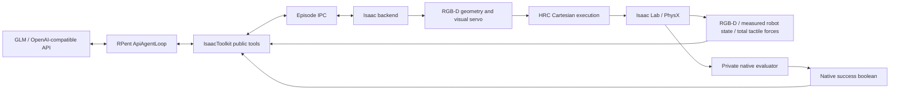

# Execution and information boundaries

`launch.py` owns a host planner and a GPU simulation container. It records the chosen commands and environment settings without the API key. When a root `.env` file exists, the container source mount masks it with `/dev/null`; the planner reads credentials from its host environment. `planner.py` composes SYSTEM.md, a public robot capability profile and the assembly task. `toolkit.py` exposes explicit actor tools, authorized memory/artifact access, and public images/state. Commands cross a per-episode JSON IPC boundary. `backend.py` executes them, records actual motion, and obtains public observations. `visual_servo.py` constructs geometry from current RGB-D selections, not scene object transforms.

`config/fixture_calibration.json`, reset scenario offsets and native evaluator geometry are private simulator configuration. Knowing them as a repository reader is different from providing them to the actor. The actor file tools remain restricted to authorized memory and recorded public artifacts; arbitrary source, evaluator, credential and private-output reads are disallowed. The default public prompt includes task semantics and nominal part dimensions, not true object poses. Scenario labels in run paths can disclose which perturbation is being tested: these experiments are not blinded recognition evaluations.

The PhysX public finger channel uses unfiltered all-object force. A legacy internal field may retain the name `finger_bolt_contacts`; its published values are total contacts and do not establish bolt identity. Native evaluation can use privileged simulator state independently. Only its final boolean is returned to the actor; evaluator diagnostics are written privately after termination.

General tools execute measured Cartesian targets with per-step clipping and existing native emergency stops. Geometry skills add measured multi-step grasp/insertion behavior; neither a successful tool return nor bilateral touch guarantees retention or completed insertion. The preserved `m1_reach` module name is historical: here it implements episode decisions, budget termination and request recording, not a reachability oracle.

No trained VLA is loaded by default. The retained generic RPC interface is an extension point, not an active policy or a substitute for action/state calibration.
